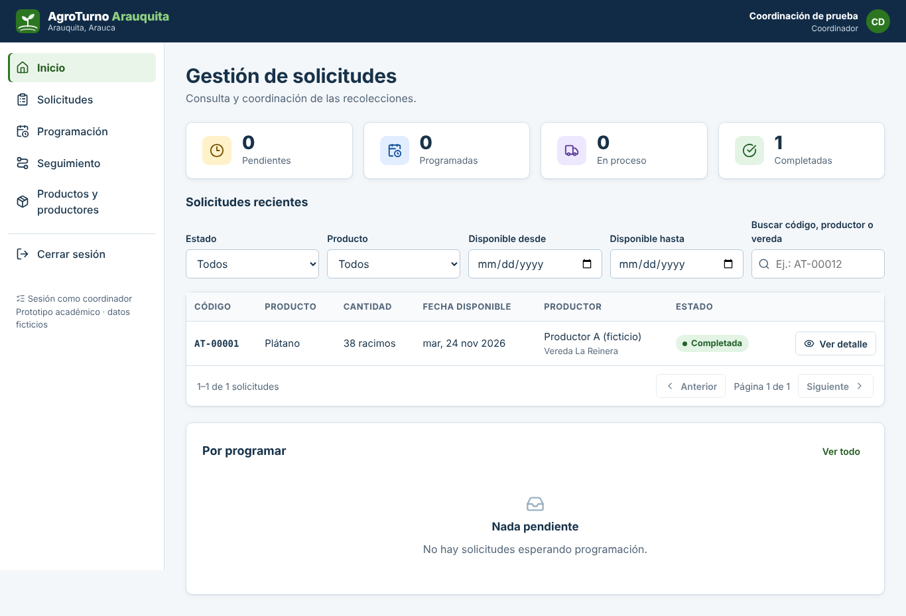
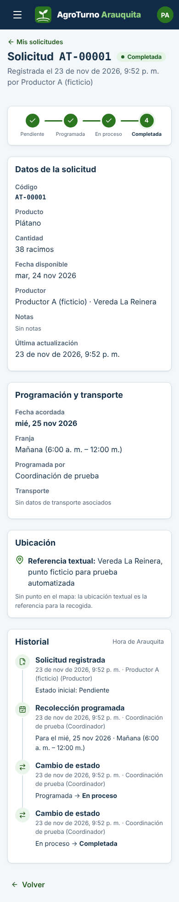

<p align="center">
  
</p>

# AgroTurno Arauquita

Prototipo web para **coordinar solicitudes de recolección y transporte de productos agrícolas** en Arauquita, Arauca. Un productor registra qué producto tiene disponible, en qué cantidad, dónde y desde cuándo; coordinación programa la atención, asocia el contacto de transporte y actualiza el estado hasta completarla. Cada cambio queda en un historial consultable.

Proyecto de grado · Ingeniería de Sistemas · Universidad Nacional Abierta y a Distancia (UNAD), curso 202016907.
Formulador: **Jhon Camilo Jiménez Meza**.

| | |
|---|---|
| Aplicación publicada | **https://agroturno-arauquita.vercel.app** |
| Estado de la API | https://agroturno-arauquita.vercel.app/api/health |
| Estado | Prototipo funcional con pruebas automatizadas. Validación con usuarios en entorno relevante: ver [docs/validacion-trl5.md](docs/validacion-trl5.md). |
| Datos | Únicamente datos ficticios. |

> **Alcance.** El sistema registra, programa y permite consultar solicitudes. **No** vende productos, no procesa pagos, no asigna rutas automáticamente, no rastrea vehículos por GPS ni calcula tiempos de llegada.

---

## Contenido

1. [Funcionalidades](#funcionalidades)
2. [Arquitectura](#arquitectura)
3. [Requisitos del equipo](#requisitos-del-equipo)
4. [Instalación local](#instalación-local)
5. [Pruebas](#pruebas)
6. [Estructura del repositorio](#estructura-del-repositorio)
7. [Documentación](#documentación)

## Funcionalidades

| Requisito | Qué hace el prototipo |
|---|---|
| RF-01 Autenticación | Inicio y cierre de sesión con correo y contraseña; sesión en cookie HttpOnly. |
| RF-02 Usuarios y roles | Roles Productor, Coordinador y Administrador. Altas, cambios de rol y desactivaciones auditadas. |
| RF-03 Productores | Perfil con vereda y teléfono opcional; consulta para coordinación. |
| RF-04 Productos | Catálogo con unidades coherentes por producto (racimos, kilogramos, bultos…). |
| RF-05 Crear solicitudes | Producto, cantidad, unidad, ubicación y fecha disponible. Código legible `AT-00001` y estado inicial *Pendiente*. |
| RF-06 Consulta y filtros | Filtros combinables por estado, producto, rango de fechas y código; paginación. El productor solo ve lo propio. |
| RF-07 Modificar solicitud | Edición autorizada con registro de cada campo cambiado (antes → después). |
| RF-08 Ubicación | Referencia textual obligatoria; punto en mapa opcional (Leaflet + OpenStreetMap) que no bloquea si falla. |
| RF-09 Programar atención | Fecha acordada y franja; reprogramación con motivo obligatorio. |
| RF-10 Datos de transporte | Contacto y tipo de vehículo asociados a la programación (sin gestión de flota). |
| RF-11 Cambiar estados | Pendiente → Programada → En proceso → Completada. Transiciones inválidas: HTTP 409. |
| RF-12 Historial | Línea de tiempo con fecha, hora, usuario, acción y motivo. Inmutable en la base de datos. |

Reglas de negocio RN-01 a RN-08 implementadas en la API y en restricciones de PostgreSQL. Detalle en [docs/matriz-requisitos-pruebas.md](docs/matriz-requisitos-pruebas.md).

## Arquitectura

Tres capas, alineadas con la Figura 2 del documento maestro:

```
 Productor · Coordinador · Administrador  (navegador móvil o de escritorio)
                    │  HTTPS · cookie de sesión HttpOnly
                    ▼
 Presentación   React 19 + TypeScript + Vite · React Router · Lucide · Leaflet
                    │  JSON en /api · autorización en el servidor
                    ▼
 Aplicación     Node.js + Express 5 + TypeScript · Zod · Helmet · bcrypt
                    │  consultas parametrizadas y transacciones (pg)
                    ▼
 Persistencia   PostgreSQL · esquema «agroturno»
```

- Ningún componente de la interfaz se conecta a la base: todo pasa por la API.
- Cada operación que cambia el estado guarda el cambio y su entrada de historial **en la misma transacción**.
- Las fechas se guardan en UTC y se muestran en hora de Arauquita (America/Bogota).
- En producción, la interfaz se sirve como sitio estático y la API como función serverless en Vercel; la base de datos es PostgreSQL administrado en Supabase, a la que la API se conecta con un rol propio de permisos mínimos.

Más detalle en [docs/arquitectura.md](docs/arquitectura.md).

## Requisitos del equipo

| Herramienta | Versión usada |
|---|---|
| Node.js | 22 LTS (22.23.5) |
| npm | 10.9 |
| PostgreSQL | 16 o superior (producción: 17) |
| Navegador | Chrome/Edge/Firefox recientes |

## Instalación local

```bash
git clone https://github.com/camilojimenez200009-sudo/agroturno-arauquita.git
cd agroturno-arauquita
npm ci
```

**1. Base de datos.** Cree la base y el rol de la aplicación (cambie las contraseñas):

```sql
CREATE ROLE agroturno_app LOGIN PASSWORD 'una-contraseña-robusta';
CREATE DATABASE agroturno;
```

**2. Variables de entorno.** Copie el ejemplo y ajuste las conexiones:

```bash
cp backend/.env.example backend/.env
```

**3. Esquema y datos ficticios:**

```bash
npm --workspace backend run db:migrar
npm --workspace backend run db:semilla              # cuentas y catálogo
npm --workspace backend run db:semilla -- --ejemplos # opcional: 3 solicitudes de ejemplo
```

La semilla crea `admin@agroturno.test`, `coordinador@agroturno.test`, `productor.a@agroturno.test` y `productor.b@agroturno.test` con la contraseña definida en `SEMILLA_CONTRASENA`.

**Datos de demostración (opcional).** Para probar todos los casos, cargue [`backend/db/datos-demo.sql`](backend/db/datos-demo.sql) con el propietario de la base (`psql "$DATABASE_URL_ADMIN" -f backend/db/datos-demo.sql`). Agrega 20 solicitudes en los cuatro estados (6 pendientes, 5 programadas, 4 en proceso y 5 completadas), con transporte, reprogramaciones con motivo, ediciones e historial; cinco productores más (`productor.c` a `productor.g@agroturno.test`), un segundo coordinador (`coordinador2@agroturno.test`), una cuenta desactivada (`inactivo@agroturno.test`) y un producto inactivo. Las cuentas nuevas usan la misma contraseña que el administrador. Personas, ubicaciones y teléfonos son inventados.

**4. Ejecutar** (dos terminales):

```bash
npm run dev:api   # API en http://localhost:3000/api
npm run dev:web   # Interfaz en http://localhost:5173
```

Comprobación rápida: `curl http://localhost:3000/api/health` → `{"estado":"ok","base_de_datos":"ok",...}`

## Pruebas

| Comando | Qué ejecuta |
|---|---|
| `npm test` | 53 pruebas de API (Vitest + Supertest): T01–T12, T15 y T18. Usan una base aislada `agroturno_test` que se recrea en cada ejecución. |
| `npm run test:e2e` | 13 pruebas de extremo a extremo (Playwright) en 4 configuraciones: Chromium escritorio y Android, Firefox escritorio y Safari iPhone. Recorrido completo, acceso denegado, conectividad (T14), compatibilidad (T13) y accesibilidad con axe (T17). |
| `npm run typecheck` | Verificación de tipos de backend y frontend. |
| `scripts/respaldo.sh` y `scripts/restaurar.sh` | Respaldo y restauración verificada por conteos (T16). |

Navegadores de prueba: `npx --prefix frontend playwright install chromium firefox webkit`.

Variables para las pruebas: `TEST_DATABASE_URL`, `TEST_DATABASE_URL_ADMIN` (deben apuntar a una base cuyo nombre termine en `_test`), `E2E_CONTRASENA` y, si no tiene los navegadores de Playwright, `CHROME_PATH`.

Resultados de la última ejecución: [docs/resultados-pruebas.md](docs/resultados-pruebas.md).

## Estructura del repositorio

```
agroturno-arauquita/
├── api/index.ts                 # Entrada de la API como función serverless
├── backend/
│   ├── db/migraciones/          # Esquema SQL versionado
│   ├── scripts/                 # Migraciones y datos ficticios
│   ├── src/
│   │   ├── routes/              # Endpoints REST y validación (Zod)
│   │   ├── services/            # Casos de uso y transacciones
│   │   ├── repositories/        # SQL parametrizado
│   │   ├── middleware/          # Sesión, roles, CSRF
│   │   └── app.ts
│   └── tests/                   # Pruebas de API
├── frontend/
│   ├── public/brand/            # Logotipos SVG e íconos
│   ├── src/components/          # Tabla, formularios, mapa, historial…
│   ├── src/pages/               # P01 a P10
│   ├── src/services/api.ts      # Cliente HTTP
│   ├── src/styles/tokens.css    # Paleta y medidas de la guía
│   └── tests/e2e/               # Pruebas de extremo a extremo
├── docs/                        # Arquitectura, API, pruebas, manual, despliegue
├── scripts/                     # Respaldo y restauración
└── vercel.json
```

## Capturas

| Tablero de coordinación | Detalle con historial (móvil) |
|---|---|
|  |  |

Más capturas del sitio publicado en [docs/capturas](docs/capturas).

## Documentación

- [Arquitectura y decisiones técnicas](docs/arquitectura.md)
- [API REST](docs/api.md)
- [Matriz requisito → pantalla → API → prueba](docs/matriz-requisitos-pruebas.md)
- [Resultados de pruebas](docs/resultados-pruebas.md)
- [Validación TRL 5: protocolo y estado](docs/validacion-trl5.md)
- [Sesión con participantes: guion, tareas y SUS](docs/sesion-participantes.md)
- [Manual breve de uso](docs/manual-usuario.md)
- [Despliegue](docs/despliegue.md)
- [Bitácora de cambios](docs/bitacora.md)

## Licencias de terceros

Íconos [Lucide](https://lucide.dev/license) (ISC). Mapas © colaboradores de [OpenStreetMap](https://www.openstreetmap.org/copyright), con atribución visible, conforme a la [política de uso de teselas](https://operations.osmfoundation.org/policies/tiles/). El logotipo es una propuesta del proyecto y no es un emblema institucional de la UNAD.
